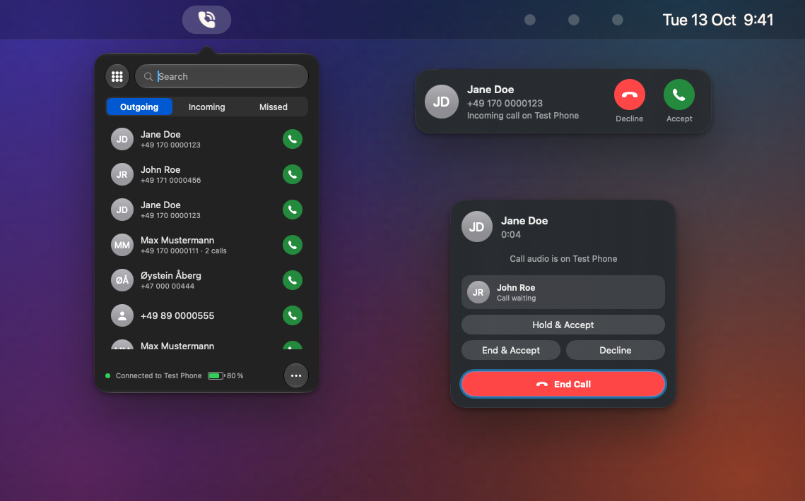
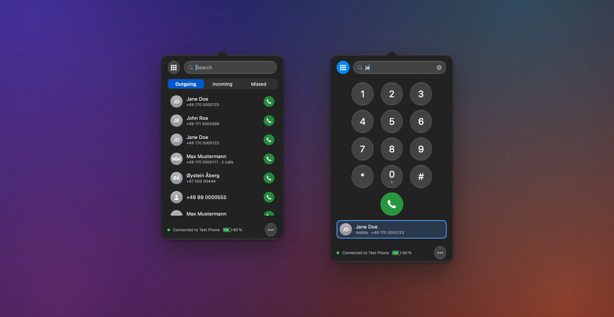
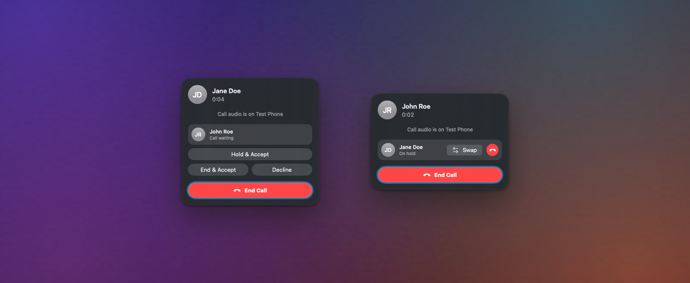
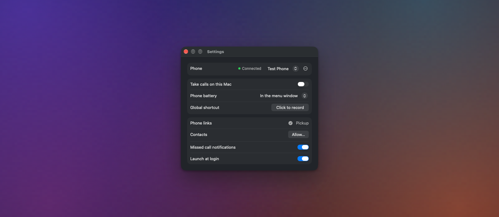

<p align="center">
  <picture>
    <source media="(prefers-color-scheme: dark)" srcset="docs/brand/readme-icon-dark.png">
    
  </picture>
</p>

<h1 align="center">Pickup for Mac</h1>
<p align="center"><strong>Android calls on macOS.</strong><br>
Your phone rings, your Mac shows who is calling. Accept, decline, dial. Nothing else in the way.</p>

<p align="center">
  
</p>

## Why Pickup

**See who is calling, right on your Mac.** Answering and placing calls from the Mac was an iPhone-only perk. Pickup brings it to Android: a call comes in, a banner appears with the name from your contacts, the number and a photo, and you accept or decline with one click. Dial from the menu bar, search your contacts by name, or click any phone number link on the web.

**No bloatware.** Pickup does calls, and the things that belong around calls. No account, no cloud, no app to install on your phone, no analytics, no network access at all. It speaks the same Bluetooth Hands-Free Profile your car kit uses, so Android already knows how to talk to it.

## Features

- **Incoming call banner** with caller name (from your Contacts), number and photo, with **Accept** and **Decline**.
- **Call window** with the running time and **End Call**. **Hold**, **Swap** between two calls, and when a second call comes in: **Hold & Accept**, **End & Accept** or **Decline** (with phones that support three-way calling).
- **Recent calls** from your phone (Outgoing, Incoming, Missed), with a call button on every row, redial, **Add to Contacts** for unknown numbers and full keyboard control. Nothing is stored on your Mac.
- **Dial from the menu bar:** a Phone-style popover with a collapsible keypad and **search by name**. Arrow keys and Return, or just type digits and the keypad opens by itself.
- **Phone number links:** click a `tel:` or `callto:` link anywhere and Pickup places the call on your phone (always after a confirmation).
- **Missed calls** as a red dot on the menu bar icon and as a notification with **Call Back**, the phone's **battery level** in the popover or the menu bar, a **global shortcut** to open the popover from anywhere, **launch at login**.
- **Reconnects by itself** when your phone goes out of range, and after the Mac wakes from sleep.
- A **resizable** popover and a **welcome window** that explains the permissions Pickup needs.
- Native **Liquid Glass** design for macOS 26, light and dark, English and German, keyboard and VoiceOver friendly.

<table>
  <tr>
    <td colspan="2"></td>
  </tr>
  <tr>
    <td></td>
    <td></td>
  </tr>
</table>

What changed in each version: [HISTORY.md](HISTORY.md).

## Requirements

- A Mac with **Apple Silicon** running **macOS 26 (Tahoe) or newer**.
- An **Android phone** that is paired with your Mac over Bluetooth. Pickup uses the standard Bluetooth Hands-Free Profile (HFP), so it should work with phones that offer it. It is developed and tested with a **Google Pixel 9 Pro (Android 17)**; other phones are untested.

## Install

> Pickup is in early development (0.x). Signed and notarized builds and Homebrew arrive with 1.0.

### From a release (0.x)

1. Download `Pickup-<version>.dmg` from the [Releases](https://github.com/macx/pickup/releases) page, open it and drag **Pickup** to **Applications**.
2. Early releases are not signed with an Apple Developer ID yet, so macOS blocks the first start. Open **System Settings → Privacy & Security**, scroll to *Security*, click **Open Anyway** next to Pickup and confirm. Or, in Terminal: `xattr -dr com.apple.quarantine /Applications/Pickup.app`.
3. Start Pickup. A phone icon appears in the menu bar.

### With Homebrew (from 1.0)

```bash
brew install --cask macx/tap/pickup
```

### From source

You need Xcode 27 and the tools in [docs/DEVELOPMENT.md](docs/DEVELOPMENT.md).

```bash
git clone https://github.com/macx/pickup.git
cd pickup
PICKUP_NO_SANDBOX=1 scripts/build-app.sh   # runs the quality gate first; PICKUP_SKIP_VERIFY=1 skips it for a quick local build
open App/.build/Pickup.app
```

## Quick start

1. **Pair your phone** with the Mac: System Settings → Bluetooth.
2. **Allow calls for the Mac on the phone:** in your phone's Bluetooth settings, open the paired Mac and switch on **Phone calls** (it appears for a moment right after pairing).
3. Click the **Pickup icon in the menu bar → ⋯ → Settings** and choose your phone. Allow **Bluetooth** when macOS asks.
4. Allow **Contacts** (caller names and search) and **Notifications** (missed calls) if you want them.
5. Optional: **make Pickup the default for phone links** and record a **global shortcut**.

Call yourself from another phone to see it work.

## Privacy

- **No network access.** The app opens no network connections and links no networking frameworks; this is checked in the build gate.
- **No third-party code** in the app and no analytics or telemetry.
- Your contacts are read on your Mac only and **kept in memory**, never written to disk or logs.
- Local logs **redact phone numbers and contact names**; dialled digits from the keypad are never logged.
- Links and pasted text cannot dial silently: `tel:` links ask first, and service codes (`*`, `#`) such as call forwarding are only accepted from the keypad.

## Honest limitations

- **The conversation stays on your phone.** Pickup is a remote control for calls, by design. macOS does not hand the Bluetooth call audio to third-party apps on current Macs, so using the Mac as the speakerphone is not possible.
- One phone at a time, one call shown in full (a waiting call is displayed, not switched to yet).
- Phone numbers are shown in a simple format; some German landline numbers appear as one block of digits.
- No call history and no SMS yet.

## Contributing

Issues and pull requests are welcome. Pull requests go to `main`, titles follow [Conventional Commits](https://www.conventionalcommits.org) (`feat: …`, `fix: …`), and every user-facing string needs an English and a German translation. Build, test and release details are in [docs/DEVELOPMENT.md](docs/DEVELOPMENT.md); the checks every change must pass are described in [docs/TESTING.md](docs/TESTING.md). [`CLAUDE.md`](CLAUDE.md) holds the same rules for AI-assisted changes.

## License

The code is released under the **MIT License** (see [LICENSE](LICENSE)). The name **Pickup** and the app icon are not covered by the license (see [TRADEMARKS.md](TRADEMARKS.md)). The icon uses artwork from [Lucide](https://lucide.dev) (ISC); see [THIRD_PARTY_NOTICES.md](THIRD_PARTY_NOTICES.md). Icon and brand assets: [docs/ICON.md](docs/ICON.md), [docs/brand](docs/brand).

© 2026 David Eiken
