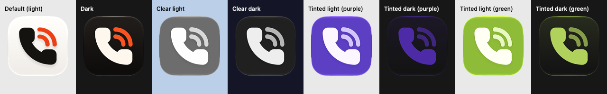

# App icon and menu bar icon

The mark is the Lucide "phone-call" icon (ISC, `THIRD_PARTY_NOTICES.md`): a filled handset plus two orange call
arcs. `scripts/generate-app-icon.swift` builds `App/Resources/Pickup.icon` (Icon Composer) and the menu bar
template PDFs in `App/Resources/MenuBar` from the Lucide path data. `scripts/render-icon-previews.sh` renders
review sheets into `App/.build/icon-preview/final` (git-ignored).

## Geometry (Lucide 24-unit grid)

| Part | Lucide | Ours | Why |
|---|---|---|---|
| Handset | outline, stroke 2 | filled outline + stroke 2.25 | Solid silhouette survives 16–32 px and matches Apple's solid Phone/Messages glyphs. |
| Arcs | stroke 2, radii 9 and 5 | stroke 2.5, radii 9 and 4.75 | Both arcs stay separate at 32 px; the smaller inner radius gives back the gap the heavier stroke took (1.75 units). |
| Placement | – | glyph box 640 × 640 on the 1024 canvas, centred | 62.5 % of the tile; Apple's Phone glyph measures 62–64 %. |

At 16 px the two arcs merge into one orange wedge; the handset and the orange accent still read.

## Colours

| | Light | Dark | Tinted |
|---|---|---|---|
| Tile | near-white #FFFDFA (system gradient) | warm ink gradient #2B2622 → #120F0D | system |
| Handset | ink #1C1814 | warm white #FFF8F1 | white |
| Arcs | #F2571A | #FF6A2B | grey #C2C2C2 |

Contrast measured in ictool's render (WCAG 2), light / dark: handset vs tile 15.9:1 / 17.6:1; arcs vs tile
3.1:1 / 6.5:1. Colour-vision simulations (Machado 2009) for the arcs, light / dark: deuteranopia 2.6 / 7.5,
protanopia 4.2 / 4.9, tritanopia 3.4 / 5.5, greyscale 3.1 / 6.5. The handset is the key glyph (always ≥ 15:1);
the arcs are the accent. No orange in the chosen range can reach more than about 3.4:1 on a near-white tile.

## Appearances

Icon Composer knows three appearance specializations in `icon.json`: the default (light), `dark` and `tinted`.
`tinted` is the "mono" input the system uses for **both** clear and tinted renditions (ClearLight, ClearDark,
TintedLight, TintedDark); it turns the layers into luminance and applies glass, translucency and the user's
tint itself. So Pickup specifies: default and dark fills (orange arcs) and one mono fill per layer (handset white,
arcs #C2C2C2; #A6A6A6 made the arcs too dim on the clear-light tile). The Assets.car built by actool contains an
`IconImageStack` for `NSAppearanceNameAqua`, `NSAppearanceNameDarkAqua` and `ISAppearanceTintable`, the two vector
layers, the gradients, and flattened fallback images (32–1024 px at 2x); `Pickup.icns` carries 16/32/128/256 px.

Contrast in ictool's 1024 px renders (WCAG 2; median of a 15 px patch on the handset's back, the outer arc and
the empty tile; tints rendered with `--tint-strength 0.75`, purple = default tint, green = hue 0.42):

| Appearance | Handset / tile | Arcs / tile | Arcs / handset |
|---|---|---|---|
| Default (light) | 15.9:1 | 3.1:1 | 5.2:1 |
| Dark | 17.6:1 | 6.5:1 | 2.7:1 |
| Clear light | 3.9:1 | 3.0:1 | 1.3:1 |
| Clear dark | 12.5:1 | 7.9:1 | 1.6:1 |
| Tinted light (purple) | 5.0:1 | 3.6:1 | 1.4:1 |
| Tinted dark (purple) | 2.4:1 | 1.9:1 | 1.3:1 |
| Tinted light (green) | 2.0:1 | 1.8:1 | 1.1:1 |
| Tinted dark (green) | 10.4:1 | 6.5:1 | 1.6:1 |

In clear and tinted the system decides the colours: the handset already uses the brightest possible mono value,
so the low numbers for tinted dark with a dark tint (purple) and tinted light with a light tint (green) are the
system's tint, not something the icon can raise. The arcs stay distinct from the handset only by brightness
(1.1–1.6:1), as in Apple's own mono icons; the shape (handset plus arcs) carries the recognition there.

## HIG compliance (Human Interface Guidelines, App icons, read 2026-10-12)

| Rule | How Pickup meets it |
|---|---|
| Layered icon made in Icon Composer; background plus one or more foreground layers | `Pickup.icon`: background fill + 2 groups (`1-handset`, `2-arcs`), numbered back to front as the Icon Composer docs suggest; limit is 4 groups. |
| Canvas 1024 × 1024, square, unmasked layers; the system applies the rounded-rect mask | Both layers are full-canvas 1024 × 1024 SVGs with no mask or tile shape. |
| Prefer vector graphics; outline artwork and text | SVG paths only, strokes expanded to outlines, no text. |
| Clearly defined edges, no soft or feathered edges | Hard-edged vector shapes. |
| Let the system handle specular highlights, shadows, bevels, blurs and glows | No effects baked in. Glass, specular highlights and the neutral shadow (0.5) are Icon Composer group settings. **Changed:** the earlier hand-made 6 pt rim layer (traced tile edge) was a custom effect and is gone; the system's own edge highlight and the dark tile's lifted gradient keep it findable, as with Apple's dark icons. |
| Background: solid colour or gradient that stands out and emphasises the foreground | System gradient (light), linear gradient (dark). |
| Keep primary content centred; simple; minimal number of shapes; you need not fill the canvas | Two shapes, box centred, 18.75 % (192 pt) margin on every side. |
| Avoid extremely thin line weights and sharp corners | Filled handset; arcs 2.5 units (72 pt at 1024) with round caps; all corners rounded. |
| Prefer filled, overlapping shapes for depth | Filled handset. The outlined Lucide handset was built for comparison and rejected: thin at 16–32 px and weak next to Apple's solid glyphs. |
| Text only if essential | None. |
| No photos, screenshots, UI replicas or Apple hardware | None. |
| Keep features consistent across default, dark, clear and tinted; dark and tinted feel at home next to system icons | Same two shapes in every appearance (no swapped or hidden elements); dark keeps the palette on a more subdued tile; the mono specialization (clear and tinted) uses explicit greys, handset white and arcs #C2C2C2, so the handset stays brightest and the arcs a step below. See *Appearances*. |
| Colour spaces: sRGB, Display P3, Gray Gamma 2.2 | sRGB. |

## Menu bar icon

Black + alpha template images, vector PDF, 18 × 18 pt, mark 15 pt (the same box as the app icon's mark), loaded
with `isTemplate = true` so the menu bar tints them for light, dark and selected. The menu bar is 24 pt high. On
light and dark bars at 1x and 2x, the 15 pt mark sits at about the optical size of SF Symbols' wifi, battery
and magnifyingglass.

- **Connected:** filled handset + arcs (arc stroke ≈ 1.7 pt).
- **Disconnected:** the handset in Lucide's own outline (stroke 2 ≈ 1.35 pt, about a regular SF Symbol's weight),
  no arcs. This mirrors the system convention `phone.fill` / `phone` that the app used before, and adds the
  arcs as a second cue, so the state reads without colour.
- Accessibility label "Pickup" (unchanged). Outside the app bundle (`swift run`, tests) the SF Symbols
  `phone.fill` / `phone` stand in, because the PDFs only exist inside `Pickup.app`.

HIG note outside the icon's scope: the menu bar HIG prefers a menu over a popover for menu bar extras. Pickup
deliberately uses a popover.

## Brand assets

`docs/brand/` holds the marketing and README images (`scripts/generate-brand-assets.sh`, see its README). The
flat and glass SVGs draw the tile with Apple's continuous-corner shape: Figma's corner-smoothing construction
(straight edge, cubic transition, circular arc, cubic transition) with radius 0.2595 and smoothing 0.64 of the tile
size, least-squares fitted to the alpha edge of ictool's 4096 px render (mean deviation 0.86 px, max 1.7 px at
4096 px; rendered at 1024 px the SVG tile differs from Apple's by at most 0.6 px).

## Not verified

Rendering in the real Dock at every size, the system's dynamic lighting, the real clear and tinted modes chosen
in System Settings (only ictool's renditions were checked), and a 1x (non-Retina) menu bar on real hardware. The Apple design-resource icon grid is a download (Figma/Sketch template) and was not used; placement
follows the measured Phone icon instead.
